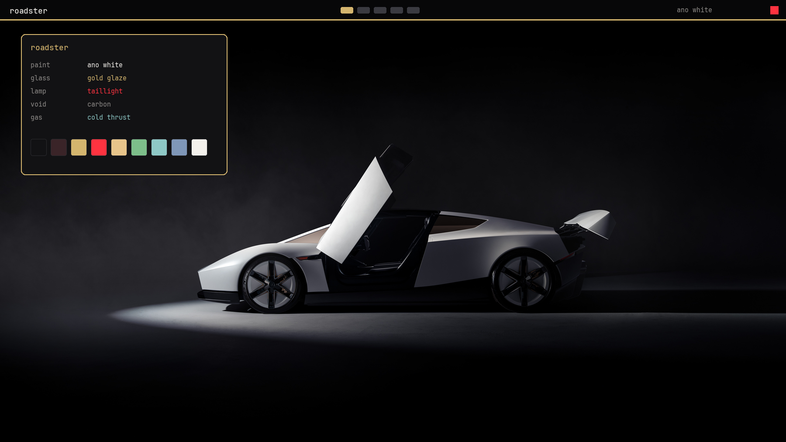

# Roadster

Ano White, gold-glazed glass, and a full-width taillight. A dark [Omarchy](https://omarchy.org/) theme built from the colors in Tesla's next-gen Roadster photographs, released 15 October 2026.



Not affiliated with Tesla or SpaceX. The photographs stay Tesla's. See [NOTICE](NOTICE).

## Install

Open the Omarchy menu (`Super + Space`), choose **Install > Style > Theme**, and paste:

```
https://github.com/IM0001GT/omarchy-roadster-theme
```

Or from a terminal:

```bash
omarchy theme install https://github.com/IM0001GT/omarchy-roadster-theme.git
```

The theme shows up as **roadster**. Cycle wallpapers with `omarchy theme bg next`.

## Palette

Sampled from the studio void, the Ano White paint, the gold-glazed glass, and the taillight. Every text color below clears WCAG AA on `#121214`.

| Role | Hex | From |
| --- | --- | --- |
| Background | `#121214` | Studio carbon |
| Dark background | `#0e0e10` | Panel shadow |
| Darker background | `#070708` | The void behind the car |
| Lighter background | `#222226` | Raised surface |
| Foreground | `#f4f1ec` | Ultrawhite seats |
| Bright foreground | `#fbfbfb` | Ano White highlight |
| Accent | `#d4b56e` | Gold-glazed glass |
| Selection | `#3a2428` | Taillight spill |
| Muted | `#8e8b88` | Microsuede and titanium |
| Red | `#ff3340` | Full-width taillight |
| Yellow | `#e7c48a` | Gold highlight |
| Orange | `#dc9068` | Desert sunset and copper |
| Green | `#7dbe8a` | Status green, kept quiet |
| Cyan | `#8ec8c6` | Cold-gas thrusters |
| Blue | `#7f97b8` | Atmosphere and cockpit glass |
| Magenta | `#d08aa0` | Red light on white paint |
| Brown | `#a88862` | Desert and bronze spokes |

Window borders run gold into taillight red. Icons are `Yaru-wartybrown`. Keyboard glow is the gold accent.

## Wallpapers

Forty-four photographs, deduplicated from the threads below. `01-side-studio.jpg` is first.

Studio and desert hero shots come first, then the night and flight shots, then the cockpit, hardware, and detail frames. A few of the later files are smaller crops from the same night.

Sources:

- [Tesla](https://x.com/Tesla/status/2110907035571401174) and [Out of this world](https://x.com/Tesla/status/2110965323054866905)
- [Sawyer Merritt](https://x.com/SawyerMerritt/status/2110912077816848877)
- [The Tesla Newswire](https://x.com/TeslaNewswire/status/2110959644982325319)
- [Chansoo](https://x.com/Chansoo/status/2110924789426831613)
- [Dirty Tesla](https://x.com/DirtyTesLa/status/2110927245241909568)
- [non aesthetic things](https://x.com/PicturesFoIder/status/2110962571474055302)
